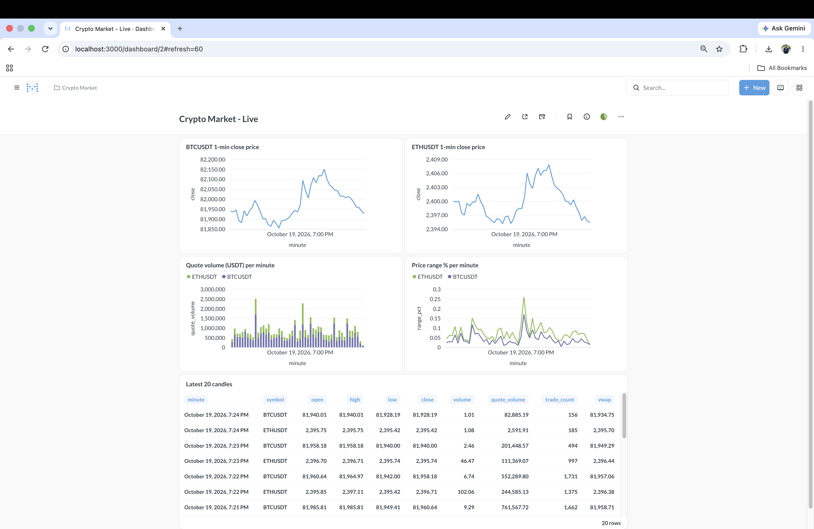
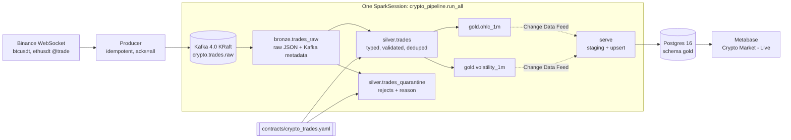
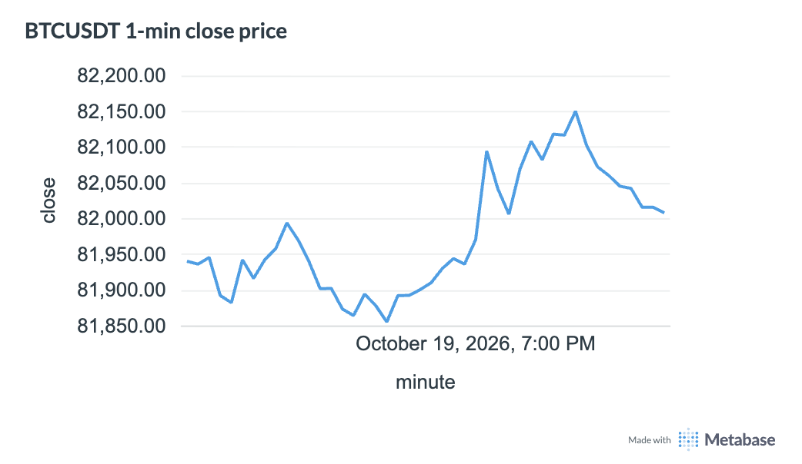
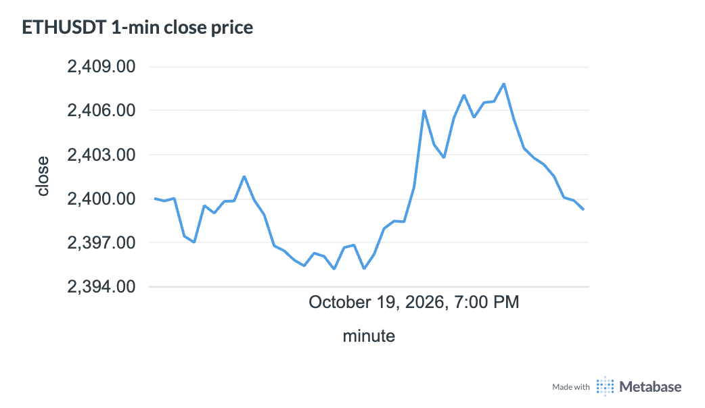
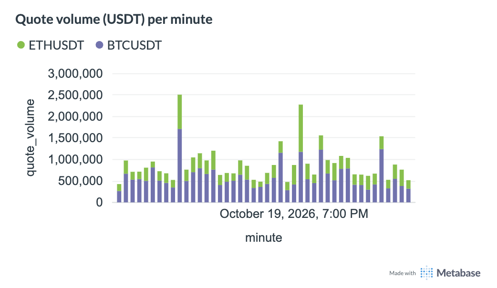
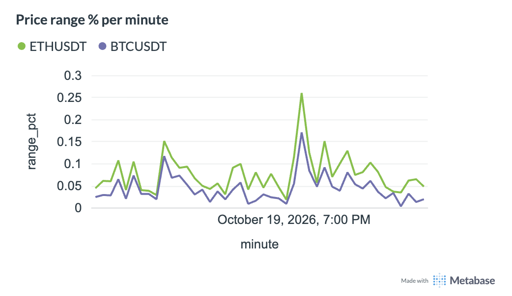

# realtime-crypto-lakehouse

A real-time crypto market-data lakehouse: live Binance trades → Kafka → Spark Structured Streaming → Delta Lake medallion → Postgres → Metabase, Databricks-ready.



Runs fully local with one `docker compose up`. The same code targets Databricks (Unity Catalog) by switching a config file, not by rewriting jobs.

## Highlights

Measured on 19 Oct 2026 from the Delta tables and Postgres after stopping the pipeline and draining every layer: 762,583 trades, 408 one-minute candles (204 per symbol, BTCUSDT and ETHUSDT).

- **Reconciles with Binance.** 198 of 202 complete one-minute candles per symbol match Binance's official klines exactly on open, high, low, close, base volume and trade count. The other 4 are the partial boundary minutes of two feed outages (the producer's WebSocket dropped; its log shows keepalive timeouts and DNS failures): Binance trade ids jump by 952,720 (BTC) and 1,227,273 (ETH) across the first outage, so those trades never reached Kafka. No ingested minute has an internal trade-id gap (0 of 408).
- **Exactly-once ingestion.** Bronze holds 762,583 live trades with 762,583 distinct Kafka offsets, contiguous from 0 to 762,582 (0 gaps), across many stops and restarts.
- **0 duplicate trades.** Silver has 762,583 rows and 762,583 distinct `(symbol, trade_id)` pairs. A replayed trade I injected was dropped: bronze 762,587 = silver 762,583 + quarantine 3 + 1 deduplicated.
- **Contract-driven quarantine.** Rules live in `contracts/crypto_trades.yaml` and are compiled to Spark at runtime. Three deliberately bad messages (negative price, unknown symbol, malformed JSON) were rejected with `price_positive`, `symbol_allowed` and `payload_is_json`.
- **Lossless serving.** Delta Change Data Feed to Postgres: 408 of 408 candles in both gold tables are identical in Delta and Postgres (0 rows on either side only). An independent batch-SQL recompute from silver also matches all 408 candles (0 mismatches), and every gold invariant holds (high ≥ low, open and close within the range, 0 duplicate `(symbol, minute)`).
- **Clean shutdown.** `docker compose stop pipeline` stops all 6 streaming queries in 2 s with exit code 0, 0 ERROR lines and 0 tracebacks. A 30 s watchdog guarantees exit.

## Architecture



| Layer | Table | Grain | Purpose |
| --- | --- | --- | --- |
| Bronze | `bronze.trades_raw` | one row per Kafka message | Append-only raw payload plus Kafka key, partition, offset and timestamp. Enables full replay. |
| Silver | `silver.trades` | one row per `(symbol, trade_id)` | Parsed with an explicit schema, `decimal(18,8)` prices, UTC timestamps, `quote_qty`, deduplicated. |
| Silver | `silver.trades_quarantine` | one row per rejected message | Original payload, the violated rule as `reason`, Kafka metadata, `quarantined_at`. |
| Gold | `gold.ohlc_1m` | one row per `(symbol, minute)` | Open, high, low, close, volume, quote volume, trade count, VWAP. |
| Gold | `gold.volatility_1m` | one row per `(symbol, minute)` | Price range, price stddev, return as a fraction, tick count. |
| Serving | Postgres `gold.*` | same as gold | Query layer for Metabase, with `PRIMARY KEY (symbol, minute)`. |

## Tech stack

| Layer | Tool | Why |
| --- | --- | --- |
| Ingest | Python 3.11, `websockets`, `confluent-kafka` | Idempotent producer (`acks=all`, lz4), keyed by symbol. |
| Broker | Apache Kafka 4.0 (KRaft) | Durable, replayable log; no ZooKeeper. |
| Processing | PySpark 3.5.9 Structured Streaming, Java 17 | Same engine locally and on Databricks. |
| Storage | Delta Lake 3.3 (`delta-spark` 3.3.3) | ACID `MERGE`, change data feed, time travel. |
| Serving | PostgreSQL 16, `psycopg` 3 | Fast dashboard queries; idempotent upserts. |
| BI | Metabase (v0.64) | Dashboard defined as code through its REST API. |
| Runtime | Docker Compose (OrbStack) | One command brings up the whole lakehouse. |
| Quality | pytest, ruff | 20 unit tests, linted and formatted. |

The Metabase image is tagged `latest` in `docker-compose.yml`; v0.64 is what the dashboard was built and tested against.

## Quick start

Prerequisites: Docker (or OrbStack) with about 4 GiB of memory available, and Python 3 on the host for the Metabase setup script (standard library only).

```bash
git clone https://github.com/Daudsaid/realtime-crypto-lakehouse.git
cd realtime-crypto-lakehouse
cp .env.example .env
```

Edit `.env` and set `MB_ADMIN_PASSWORD` to a long password of your own, then start everything:

```bash
docker compose up -d --build
```

This starts Kafka, Postgres, Metabase, the Binance producer and the `pipeline` service (bronze, silver, gold and serve in one Spark session). Give it a couple of minutes for the first candles to land, then create the dashboard and check the stack:

```bash
python3 scripts/setup_metabase.py
bash scripts/healthcheck.sh
```

The setup script is idempotent and prints the dashboard URL (open it, then log in with `MB_ADMIN_EMAIL` and `MB_ADMIN_PASSWORD` from `.env`). Re-run it any time to restore the dashboard. If it warns that the gold tables are not synced yet, wait a minute and run it again.

Services and ports:

| Service | URL or endpoint | Notes |
| --- | --- | --- |
| Metabase | http://localhost:3000 | Dashboard and admin login |
| Postgres | localhost:5432 | Database `crypto`, schema `gold` (credentials in `.env`) |
| Kafka | localhost:9092 | Topic `crypto.trades.raw`; `kafka:29092` inside Docker |
| `pipeline` | none | Bronze, silver, gold and serve in one Spark session |
| `spark` | none | Idle container for `docker compose exec` (tests, lint, ad-hoc jobs) |

Useful commands:

```bash
docker compose logs -f pipeline
docker compose exec spark pytest -q
docker compose exec spark ruff check src tests
docker compose stop pipeline
```

To run a single layer by hand, stop `pipeline` first because both use the same checkpoints:

```bash
docker compose stop pipeline
docker compose exec spark python -m crypto_pipeline.silver
```

## Data contract

`contracts/crypto_trades.yaml` (ODCS-style, version 1.0.0) is the single source of truth for what a valid trade is. The `required` flags in its schema and its `quality` rules are read at runtime by `crypto_pipeline/contract.py`, so rules are never hard-coded twice.

```yaml
quality:
  - name: payload_is_json
    rule: valid_json
  - name: required_not_null
    rule: required_fields        # every schema property with required: true
  - name: price_positive
    rule: positive
    column: price
  - name: symbol_allowed
    rule: allowed_values
    column: symbol
    values: [BTCUSDT, ETHUSDT]
  - name: trade_time_not_future
    rule: max_future_minutes
    column: trade_time
    minutes: 5
```

Each `rule` maps to a function that returns Spark column expressions. The reason for a row is the first violated rule in contract order (`F.coalesce(F.when(violation, rule_name), ...)`); a NULL reason means the row is valid. Two streaming queries read bronze: valid rows are deduplicated into `silver.trades`, the rest go to `silver.trades_quarantine`.

Possible reasons: `payload_is_json`, `required_not_null:<field>`, `price_positive`, `qty_positive`, `symbol_allowed`, `trade_time_not_future`.

## Key design decisions

**Bronze is raw and append-only.** The payload is stored unparsed with Kafka metadata, so silver and gold can be rebuilt or re-validated against a new contract version without going back to the source.

**One code path for local and Databricks.** `conf/local.yml` sets `use_tables: false` and addresses Delta by path under `data/lakehouse/<layer>/<table>`. `conf/databricks.yml` sets `use_tables: true` and addresses Unity Catalog tables `<layer>.<table>`. Every read, write and checkpoint goes through `tables.py`, so jobs contain no paths. The serve job is a no-op on Databricks, where gold is queried directly with Databricks SQL.

**Keyed by symbol.** Kafka keys are the symbol, which keeps per-symbol ordering. With two symbols the live trades hash to one partition, an accepted trade-off at this scale; more symbols spread across the other partitions.

**Deduplication with a bounded state.** `withWatermark("trade_time", "10 minutes")` plus `dropDuplicatesWithinWatermark(["symbol", "trade_id"])` removes replays without unbounded state. The batch branch of `dedupe_trades` uses plain `dropDuplicates` on the same keys, which keeps the function unit-testable.

**Deterministic open and close.** Trades often share a millisecond, so `min_by`/`max_by` order by `struct(trade_time, trade_id)`. Binance trade ids are sequential, which makes the candle match the exchange's own.

**Late trades update candles through `MERGE`.** Gold aggregates in update mode with a 2-minute watermark and upserts both tables from one `foreachBatch`. A late trade inside the watermark re-emits the full candle and the `MERGE` rewrites it, so replays are idempotent.

**Change Data Feed to Postgres.** Gold tables have the feed enabled. Serve keeps the newest post-image per `(symbol, minute)` in each batch, writes it to a staging table over JDBC, then runs `INSERT ... ON CONFLICT (symbol, minute) DO UPDATE`. Retries and restarts cannot create duplicates. The initial snapshot backfills history.

**One SparkSession locally.** `run_all` starts bronze, silver, gold and serve as six queries in a single JVM, which fits comfortably in a laptop's Docker memory. Each query still has its own checkpoint, and each job keeps its own entrypoint.

**Case-sensitive Spark.** Binance trade payloads contain keys that differ only by case (`t` trade id and `T` trade time, `e`/`E`, `m`/`M`). Spark's default case-insensitive resolution raises an ambiguous-field error, so the session sets `spark.sql.caseSensitive=true`.

## Engineering challenges solved

**Shutdown hang (py4j signal-handler deadlock).** *Problem:* a job ignored `timeout -s INT` and never exited. *Root cause:* `py-spy dump` showed the main thread blocked inside `threading.Event.set()` called from my signal handler. `timeout` delivers SIGINT twice (to the process and its group), and the second handler re-entered the lock the first one held. *Fix:* the handler only assigns a timestamp (lock-free), the main loop polls it, and a daemon watchdog thread calls `os._exit(1)` if shutdown exceeds 30 s.

**Zombie JVMs.** *Problem:* every job run left a `[java] <defunct>` process in the container. *Root cause:* the Spark JVM is orphaned when Python exits and was reparented to PID 1, which was `sleep infinity` and never reaps children. *Fix:* `init: true` in Compose, so `tini` is PID 1.

**Malformed JSON looked like a missing symbol.** *Problem:* a truncated payload was quarantined as `required_not_null:symbol`, not as bad JSON. *Root cause:* `from_json` in PERMISSIVE mode returns a struct of NULLs, not a NULL struct. *Fix:* add a `_corrupt_record` field to the schema and treat it (or a NULL struct) as `payload_is_json`.

**Delta `MERGE` crash.** *Problem:* the gold `foreachBatch` failed with `key not found: symbol#808`. *Root cause:* `batch.persist()` put an `InMemoryRelation` in the plan, which Delta's `MERGE` could not remap. *Fix:* no caching inside `foreachBatch`; the batch is recomputed per `MERGE`.

## Dashboard

`scripts/setup_metabase.py` creates the collection, database connection and the "Crypto Market - Live" dashboard through Metabase's REST API, and archives cards it no longer defines. It also sets the report timezone to Europe/London and selects `minute AT TIME ZONE 'UTC'` so Metabase converts the stored UTC timestamps instead of relabelling them.

| | |
| --- | --- |
|  |  |
| **BTC and ETH move together.** The correlation of their 1-minute returns is 0.915. | **Same shape, different scale.** ETH trades near 2,400 USDT against BTC near 82,000 USDT. |
|  |  |
| **BTC dominates traded value.** BTCUSDT is 68.7% of all quote volume (133.7M of 194.7M USDT). | **ETH is consistently more volatile.** Its average one-minute range is 0.071% against 0.047% for BTC, and wider than BTC's in 86.8% of minutes. Volume spikes coincide with volatility spikes (correlation of quote volume and range: 0.62 for BTC, 0.54 for ETH). |

## Repository structure

```text
.
├── docker-compose.yml        Kafka, Postgres, Metabase, producer, spark (exec) and pipeline services
├── conf/
│   ├── local.yml             Delta paths, Kafka and trigger settings for Docker
│   └── databricks.yml        Unity Catalog profile (use_tables: true)
├── contracts/
│   └── crypto_trades.yaml    Data contract enforced by silver
├── producer/                 Binance WebSocket to Kafka producer (own Dockerfile)
├── spark/Dockerfile          Python 3.11, Java 17, PySpark, Delta
├── postgres/init/            Creates the metabase database and gold schema
├── src/crypto_pipeline/
│   ├── config.py             Frozen config from conf/<env>.yml plus env overrides
│   ├── spark.py              SparkSession factory (local Delta or Databricks)
│   ├── tables.py             Path/UC addressing, streaming I/O, MERGE, shutdown handling
│   ├── schemas.py            Binance schema and gold table schemas
│   ├── contract.py           Contract loader and rule compiler
│   ├── bronze.py             Kafka to bronze.trades_raw
│   ├── silver.py             Parse, validate, dedupe, quarantine
│   ├── gold.py               1-minute OHLC and volatility candles
│   ├── serve.py              Change Data Feed to Postgres upserts
│   └── run_all.py            All four jobs in one SparkSession
├── scripts/
│   ├── setup_metabase.py     Idempotent Metabase setup (dashboard as code)
│   └── healthcheck.sh        Stack smoke test
├── tests/                    pytest suite (20 tests)
└── docs/screenshots/         Dashboard images used in this README
```

## Testing

```bash
docker compose exec spark pytest -q
```

20 unit tests run on small static DataFrames with a local Spark session; no Kafka or Delta is needed.

| File | Tests | Covers |
| --- | --- | --- |
| `tests/test_silver.py` | 6 | Valid trade passes and projects `quote_qty`; negative price, unknown symbol and malformed JSON map to the right reason; dedupe on a duplicate pair. |
| `tests/test_gold.py` | 6 | OHLC with shuffled input and a same-millisecond tie, volume, VWAP, stddev, range, return, single-tick candles, per-symbol separation. |
| `tests/test_serve.py` | 5 | Newest-version selection from change-feed batches, delete handling, Postgres DDL and types, upsert SQL. |
| `tests/test_tables.py` | 3 | Lock-free stop flag and the expected-shutdown log downgrade. |

## Roadmap

Done:

- [x] Kafka producer, KRaft broker, Postgres and Metabase in Docker Compose
- [x] Bronze, silver (data contract, dedupe, quarantine) and gold (OHLC, volatility) streaming jobs
- [x] Idempotent Change Data Feed serving to Postgres
- [x] Single-session `pipeline` service with clean shutdown
- [x] Metabase dashboard as code
- [x] Unit tests and lint (run locally in the container)

Next:

- [ ] CI with GitHub Actions (ruff and pytest); `.github/workflows/ci.yml` is still empty
- [ ] Databricks deployment with Declarative Automation Bundles and Unity Catalog. The config switch and `conf/databricks.yml` exist, but the bundle (`databricks.yml`) is not written and nothing has run on Databricks yet
- [ ] dbt-databricks for the gold layer
- [ ] More symbols, which also spreads load across Kafka partitions
- [ ] Alerting, including a data-completeness check on trade-id gaps (the outages above were found by hand)
- [ ] Pin the Metabase image version

## Author

**Daud Abdi**, Associate Data Engineer, London, UK

[GitHub](https://github.com/Daudsaid) · [LinkedIn](https://www.linkedin.com/in/daudabdi0506) · [daudabdi.com](https://daudabdi.com) · [daudsaidabdi@gmail.com](mailto:daudsaidabdi@gmail.com)
